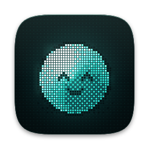
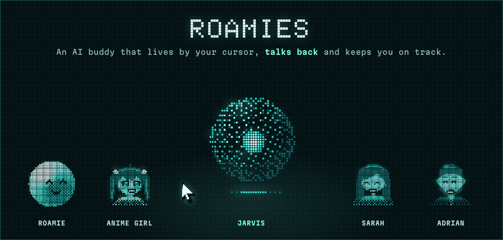

<p align="center">
  
</p>

<p align="center">
  
</p>

<h1 align="center">Jarvis</h1>

<p align="center">
  <strong>An AI companion that lives on your screen and works from your second brain.</strong>
</p>

<p align="center">
  <a href="LICENSE"></a>
</p>

Jarvis is a desktop AI buddy for macOS, Windows and Linux (beta). It stays by your cursor, talks back in its own
voice, keeps track of what you said you'd do, and can point at, draw on and work the apps on your screen. This
version adds a **second brain**: point it at a folder of your own notes (an Obsidian vault, a context repo) and the
chat works from it.

Jarvis is a modified version of [Roamies](https://github.com/KenKaiii/Roamies) by Ken Kai. See [Credits](#credits).

## What it does

- **Talk, don't type.** Hold ⌃⌥ (Ctrl+Alt on Windows and Linux), say it, let go. On macOS and Windows, circle something with the cursor while you talk and it sees what you mean.
- **Or type.** Tap ⌥⌘ (Ctrl+Shift on Windows and Linux) and a small text field opens beside your cursor.
- **It talks back.** Spoken replies through [Fish Audio](https://fish.audio), a Gemini voice with your own [Google AI Studio](https://aistudio.google.com/apikey) key, or the local VoiceStudio app.
- **It remembers.** Commitments, reminders (one-off or on repeat) and what matters to you.
- **It draws on your screen.** Rings the exact button to click, walks you through each step, and sketches answers (cards, graphs, timelines, 3D models) beside what you're reading.
- **It does the clicking.** Opens apps, sites and files, and on macOS and Windows clicks or types in other apps for you.
- **Your subscriptions.** Sign in with Claude or ChatGPT, use an API key (Gemini, Grok, Kimi Code and more), or a local model (Ollama, LM Studio, any OpenAI-compatible server).
- **Skills, connections and jobs.** Install skills by asking, connect apps through their MCP servers, and schedule background agents to work at set times.
- **Safe by default.** File edits, commands and app control stay off until you turn them on, and risky steps always ask.

| Look       | What you get                                            |
| ---------- | ------------------------------------------------------- |
| **JARVIS** | **A glowing sphere of light that ripples as it speaks** |
| Roamie     | The original: a tiny glowing pixel creature             |
| GlayOS     | A pixel robot head with one glowing eye                 |
| Ultren     | A pixel chrome robot with glowing eyes                  |
| Anime Girl | A pixel anime girl                                      |
| Sarah      | A pixel woman                                           |
| Adrian     | A pixel man                                             |
| Rita X     | A pixel secretary in cat-eye glasses                    |

<sub>The character art and looks are Ken Kai's work from Roamies. Some looks are fan tributes to characters from films and games. This is a free project, not affiliated with or endorsed by Marvel, Disney or Valve, and all trademarks belong to their owners. If you hold the rights to one and want it removed from this repository, [open an issue](https://github.com/EricTechPro/jarvis/issues).</sub>

## Second brain

The panel's **Second brain** page connects Jarvis to a folder of your notes. Pick **Use an Existing Folder** or
**Create a New One** (Jarvis makes the folders plus a starter `AGENTS.md` and index files, never over an existing
file), then check its locations. Each has **Choose Folder…**:

| Location       | Looked for in the root as | What Jarvis does with it                                          |
| -------------- | ------------------------- | ----------------------------------------------------------------- |
| Root           | (the folder you pick)     | Relative file paths in the chat resolve here                      |
| Raw evidence   | `_raw`                    | Reads and cites it; **read-only**, nothing in it is ever changed  |
| Context (wiki) | `_context` or `wiki`      | Summarised memory and notes; read first                           |
| Research       | `_research`               | Write-ups built from the context                                  |
| Projects       | `projects`                | Your project folders                                              |
| Agents folder  | `.agents`                 | Its `skills/` show beside your own skills                         |

Unset locations are found in the root again at each new chat; a location you chose is never replaced. The root's
`AGENTS.md` (or `CLAUDE.md`) rides in the system prompt, capped so small local models still fit. Every location has to
be inside your home folder. Jarvis's own data (settings, memory, chats, skills) stays in `~/Roamies`, apart from
your notes.

The raw folder is enforced, not just asked for: file writes, redirects and changing commands (`rm`, `mv`, `cp` into,
`touch`, `sed -i`, `find -delete`, `sh -c`) that touch it are refused, following links and in any letter case. Background
agents get the same rule. Secret files inside the folder stay blocked as everywhere else.

## Build and run

There are no prebuilt downloads. Build it from source with Rust, Node.js 22+, the
[Tauri prerequisites](https://v2.tauri.app/start/prerequisites/) and, on macOS, the Xcode Command Line Tools:

```bash
git clone https://github.com/EricTechPro/jarvis.git
cd jarvis/showcase/tauri
(cd sidecar && npm ci && npm test)
./build.sh dev        # debug build
./build.sh            # release bundle for this OS
```

On Windows, run these in **Git Bash** (it comes with [Git for Windows](https://git-scm.com/download/win)), not
PowerShell or Command Prompt: `build.sh` is a Bash script.

Then open the app, follow the setup guide, pick a look, and hold ⌃⌥ (Ctrl+Alt on Windows and Linux) to say hi.

<sub>The first time you sign in with Claude, Jarvis downloads Claude Code (about 140 MB). On Windows and Linux, the
speech model ([NVIDIA Parakeet TDT 0.6B v3](https://huggingface.co/nvidia/parakeet-tdt-0.6b-v3), CC BY 4.0, about
670 MB) downloads once at setup.</sub>

**In-app updates are off.** This build never checks for or installs updates: there is no signing key or update feed.
To update, pull and build again. To turn updates on with your own feed, see `UPDATES_ENABLED` in
`showcase/tauri/src-tauri/src/main.rs`.

### Platforms

|                        | macOS                  | Windows                     | Linux (beta)                     |
| ---------------------- | ---------------------- | --------------------------- | -------------------------------- |
| Talk to it             | Yes, best on macOS 26+ | Yes, speech runs on your PC | Yes, speech runs on your PC      |
| Circle while talking   | Yes                    | Yes                         | No                               |
| Read windows and point | Yes                    | Yes                         | Points from screenshots only     |
| Click and type in apps | Yes                    | Yes                         | No                               |
| Show or hide           | ⌃⌥S                    | Ctrl+Shift+S                | Ctrl+Alt+S, or a key you bind\*  |
| Talk shortcut          | Hold ⌃⌥                | Hold Ctrl+Alt               | Hold Ctrl+Alt, or a key you bind\* |

<sub>\* On Wayland, apps can't grab keys, so you bind the commands (`roamies --talk`, `--summon`, `--ask`, `--list`,
`--panel`) to keys in your desktop's keyboard settings. The panel lists them with a **Copy** button. On GNOME, tray
icons need the [AppIndicator extension](https://extensions.gnome.org/extension/615/appindicator-support/).</sub>

## Local models

Connect Ollama, LM Studio or any OpenAI-compatible server (llama.cpp, vLLM, oMLX) on the panel's **Model** page. A
model has to see images, call tools, point precisely at things on a screenshot, and have 32k tokens of context or more.
The Qwen3-VL family (8B and up; 30B-A3B is the best pick if it fits) works well. Smaller models can chat about your
screen but often point at the wrong place; **Lite mode** on the Model page suits them.

## Privacy

No analytics, and nothing is collected by the developer. Your messages, and screenshots when you ask about the
screen, go to the AI provider you pick. [PRIVACY.md](PRIVACY.md) lists what's sent where. Voice keys are kept in the
macOS Keychain (Windows DPAPI, or your desktop keyring on Linux); AI sign-ins are stored in `~/.gg/auth.json`, shared
with GG Coder.

## Uninstall

1. Turn off **Open at login** in the panel, then quit Jarvis from its menu bar or tray menu.
2. Delete the app (macOS: drag it from Applications to the Trash; Windows: Settings > Apps; Linux: remove the package or AppImage).
3. Delete the `~/Roamies` folder (`%USERPROFILE%\Roamies` on Windows): settings, memory, chats, skills and agent output. Your second brain folder is yours and is not touched.
4. Remove the voice keys: on macOS, search Keychain Access for "Jarvis"; on Linux, `secret-tool clear service com.erictech.jarvis account fish-audio`.

## Contributing

Bug reports, ideas and pull requests are welcome. [Open an issue](https://github.com/EricTechPro/jarvis/issues),
read [CONTRIBUTING.md](CONTRIBUTING.md) before a pull request, and report security problems as described in
[SECURITY.md](SECURITY.md).

## Credits

Based on [Roamies](https://github.com/KenKaiii/Roamies) by Ken Kai, licensed AGPL-3.0. Modified by Eric Tech,
2026-11-22: renamed, second-brain folder support, updater disabled.

The agent runs on Ken Kai's [gg-framework](https://github.com/KenKaiii/gg-framework) (`@kenkaiiii/gg-*`). Third-party
components and their licenses are listed in [THIRD_PARTY_NOTICES.md](THIRD_PARTY_NOTICES.md).

## License

[AGPL-3.0](LICENSE), the same license as Roamies. You can build on it; if you distribute your changes or run them as
a network service, you share their source under the same license.
